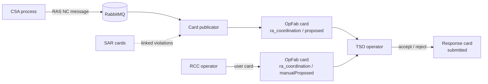

# RAS process

Remedial Action Schedule (RAS): a remedial action proposed by the RCC to a TSO.
The TSO accepts or rejects it in OpFab.

## Overview

## Steps

1. **Input.** CSA publishes a RAS NC message. Alternatively, an RCC operator
   creates a manual proposal through the OpFab user card.
2. **Conversion.** The card publicator converts the XML into card data.
3. **Enrichment.** Reference data and linked SAR violations are added.
4. **Publication.** The card is sent to the RCC and the target TSO.
5. **Response.** The TSO accepts or rejects the proposal (with a reason).
6. **Storage.** The card retriever stores the cards in Elasticsearch.

## OpFab cards

| | Automatic | Manual |
|---|---|---|
| Process / state | `ra_coordination` / `proposed` | `ra_coordination` / `manualProposed` |
| Created by | Card publicator | RCC operator (user card) |
| Recipients | Publisher entity and target TSO | Target TSO |
| Response state | `submitted` | `submitted` |
| Bundle | `opcoordplatform`: `process_bundles/coordination` | same |

## Open points

- _TBD_
